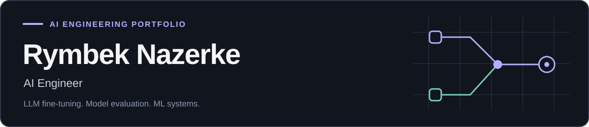

  

I'm **Rymbek Nazerke, an AI Engineer** focused on **LLM fine-tuning, model evaluation, and ML systems**. I build reproducible experiments and practical AI tools, with attention to data quality, numerical correctness, and inspectable results.

**Explore:** [Fine-tuning & evaluation](https://github.com/nazek52/tuneproof) · [Training kernels](https://github.com/nazek52/soup-kernel-lab) · [Applied AI demo](https://nazek52.github.io/FloodShield/)

## Selected projects

<table>
<tr>
<td width="50%" valign="top">

### TuneProof
**LLM fine-tuning & evaluation**

A CPU-runnable LoRA experiment with a causal transformer, leakage-aware dataset splits, held-out evaluation, and a zero-learning-rate control.

Python · PyTorch · LoRA

[Repository](https://github.com/nazek52/tuneproof) · [Evidence](https://github.com/nazek52/tuneproof/blob/main/evidence/README.md)

</td>
<td width="50%" valign="top">

### Soup Kernel Lab
**Training kernels & numerical correctness**

Custom Triton RMSNorm and cross-entropy kernels with value and gradient checks, CPU reports, and a benchmark notebook. GPU performance is not yet measured.

Python · PyTorch · Triton

[Repository](https://github.com/nazek52/soup-kernel-lab) · [Validation](https://github.com/nazek52/soup-kernel-lab/blob/main/docs/VALIDATION.md)

</td>
</tr>
<tr>
<td width="50%" valign="top">

### Drift Sentinel
**Temporal evaluation & model monitoring**

Chronological evaluation, delayed-label cutoffs, baseline comparisons, and drift diagnostics for a reproducible synthetic incident dataset.

Python · scikit-learn · MLOps

[Repository](https://github.com/nazek52/drift-sentinel) · [Model card](https://github.com/nazek52/drift-sentinel/blob/main/docs/model-card.md)

</td>
<td width="50%" valign="top">

### FloodShield
**Applied AI & field evidence**

Source-linked field-report extraction with a server-side Meta integration, human review, and geospatial scenarios. The static demo supports simulation and manual review.

JavaScript · Node.js · GeoJSON · Meta API

[Repository](https://github.com/nazek52/FloodShield) · [Live demo](https://nazek52.github.io/FloodShield/)

</td>
</tr>
<tr>
<td width="50%" valign="top">

### Release Guard
**Reliable delivery & decision gates**

An explainable canary gate returning PASS, FAIL, or HOLD from baseline and candidate metrics. Missing or insufficient evidence blocks promotion.

Python · statistics · Docker · CI/CD

[Repository](https://github.com/nazek52/release-guard) · [Verification](https://github.com/nazek52/release-guard/blob/main/docs/verification.md)

</td>
<td width="50%" valign="top">

### Trace Lens
**Observability & developer tools**

Explore OTLP traces in a local browser waterfall, inspect error spans, and investigate latency. Trace data stays in the browser.

TypeScript · React · Web Workers

[Repository](https://github.com/nazek52/trace-lens) · [Interface](https://github.com/nazek52/trace-lens/blob/main/docs/preview.png)

</td>
</tr>
</table>

## Engineering toolkit

| Focus | Technologies & methods |
| :--- | :--- |
| LLM engineering | Python, PyTorch, LoRA, causal transformers, held-out evaluation |
| ML systems & monitoring | Triton, numerical validation, scikit-learn, temporal splits, drift diagnostics |
| Backend & delivery | FastAPI, SQLite, PostgreSQL, Docker, GitHub Actions |
| Interfaces & observability | TypeScript, React, OpenTelemetry, Prometheus, Grafana |
| Verification | pytest, Playwright, reproducible reports, integrity manifests |

## Supporting engineering work

- **[Relay Ledger](https://github.com/nazek52/relay-ledger)** — durable webhook delivery with idempotency, signed payloads, retries, and worker-crash recovery.
- **[Shift Ledger](https://github.com/nazek52/shift-ledger)** — incident ownership and acknowledged handoffs with role checks and a versioned audit trail.

<strong>Infrastructure labs & project walkthroughs</strong>

- [Service Observability & Recovery](https://github.com/nazek52/service-observability-recovery-lab) — PostgreSQL, Prometheus/Grafana, and outage/recovery exercises.
- [Containerized Service Delivery](https://github.com/nazek52/containerized-web-service-delivery-lab) — a focused container delivery lab.
- [TuneProof: русский разбор](https://github.com/nazek52/tuneproof/blob/main/docs/DEFENSE_RU.md)
- [Soup Kernel Lab: устройство проекта](https://github.com/nazek52/soup-kernel-lab/blob/main/docs/START_HERE_RU.md)

For each project, start with its documented demo, review the recorded evidence, and inspect the implementation and its limitations.

---

Independent portfolio projects developed with AI assistance. Synthetic data, measured results, and experimental limits are documented in each repository. These projects do not imply production employment, customer deployments, or production SLAs.
