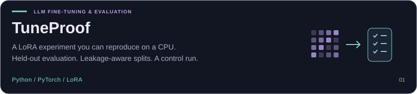
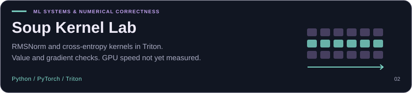
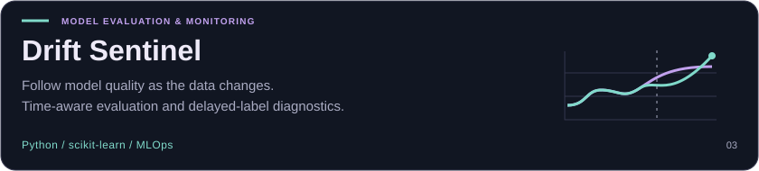
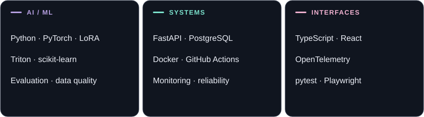
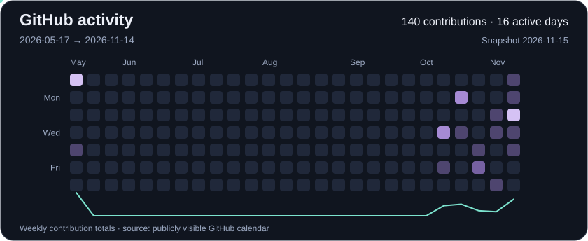

  <picture>
    <source media="(prefers-reduced-motion: reduce)" srcset="assets/ai-atelier-static.webp">
    
  </picture>

<h1 align="center">Rymbek Nazerke</h1>

<strong>AI Engineer</strong>

  <picture>
    <source media="(prefers-reduced-motion: reduce)" srcset="assets/focus-static.svg">
    
  </picture>

From training loops to useful tools. Reproducible experiments · Careful evaluation · Open-source contributions

  
  
  

  <a href="#recognition">Recognition</a> &nbsp;·&nbsp;
  <a href="#open-source-contributions">Open source</a> &nbsp;·&nbsp;
  <a href="#selected-projects">Projects</a> &nbsp;·&nbsp;
  <a href="#toolkit">Toolkit</a> &nbsp;·&nbsp;
  <a href="#activity">Activity</a>

I'm **Nazerke, an AI Engineer** working on LLM fine-tuning, model evaluation, and ML systems. I build experiments with inspectable results and interfaces that make engineering work easier to understand. Based in **Astana, Kazakhstan**.

## Recognition

> **TuneProof · selected for XERJ Corpus Hub**  
> In November 2026, XERJ selected my CPU LoRA implementation for inclusion in its reference-code index, with author and repository attribution.  
> [About XERJ](https://github.com/xerj-org/xerj) · [Selection details](https://github.com/nazek52/tuneproof/blob/main/docs/XERJ_RECOGNITION.md)

## Open-source contributions

Selected changes **merged into [Soup](https://github.com/MakazhanAlpamys/Soup)**, an LLM training toolkit. Each link opens the accepted pull request.

| Area | Contribution |
| :--- | :--- |
| Training experience | [Remaining time and estimated finish in the live training panel ↗](https://github.com/MakazhanAlpamys/Soup/pull/2707) |
| Experiment tracking | [Compare full run configs, dataset hashes and evaluation scores ↗](https://github.com/MakazhanAlpamys/Soup/pull/2706) |
| Model recipes | [Qwen3.5-122B-A10B text MoE GRPO starting configuration ↗](https://github.com/MakazhanAlpamys/Soup/pull/2660) |
| Training correctness | [Preserve fitting preference prompts in MLX DPO, ORPO and SimPO ↗](https://github.com/MakazhanAlpamys/Soup/pull/2659) |

Verified merged on 15 November 2026. AI-assisted contributions; test scope and hardware limitations are documented in each PR.

## Selected projects

<a href="https://github.com/nazek52/tuneproof">
  <picture>
    <source media="(max-width: 600px) and (prefers-color-scheme: light)" srcset="assets/projects/tuneproof-light-mobile.svg">
    <source media="(max-width: 600px)" srcset="assets/projects/tuneproof-dark-mobile.svg">
    <source media="(prefers-color-scheme: light)" srcset="assets/projects/tuneproof-light.svg">
    
  </picture>
</a>

[Read the experiment evidence →](https://github.com/nazek52/tuneproof/blob/main/evidence/README.md)

<a href="https://github.com/nazek52/soup-kernel-lab">
  <picture>
    <source media="(max-width: 600px) and (prefers-color-scheme: light)" srcset="assets/projects/soup-kernel-lab-light-mobile.svg">
    <source media="(max-width: 600px)" srcset="assets/projects/soup-kernel-lab-dark-mobile.svg">
    <source media="(prefers-color-scheme: light)" srcset="assets/projects/soup-kernel-lab-light.svg">
    
  </picture>
</a>

[Explore the implementation →](https://github.com/nazek52/soup-kernel-lab/blob/main/docs/START_HERE_RU.md)

<a href="https://github.com/nazek52/drift-sentinel">
  <picture>
    <source media="(max-width: 600px) and (prefers-color-scheme: light)" srcset="assets/projects/drift-sentinel-light-mobile.svg">
    <source media="(max-width: 600px)" srcset="assets/projects/drift-sentinel-dark-mobile.svg">
    <source media="(prefers-color-scheme: light)" srcset="assets/projects/drift-sentinel-light.svg">
    
  </picture>
</a>

## More engineering

| Project | What it explores |
| :--- | :--- |
| **[FloodShield](https://github.com/nazek52/FloodShield)** | Applied AI for source-linked field reports, human review and geospatial scenarios. [Try the simulation demo ↗](https://nazek52.github.io/FloodShield/) |
| **[Release Guard](https://github.com/nazek52/release-guard)** | Explainable canary decisions: PASS, FAIL or HOLD from baseline and candidate metrics. |
| **[Trace Lens](https://github.com/nazek52/trace-lens)** | A browser trace explorer for OTLP waterfalls and latency investigations; trace data stays local. |

## Toolkit

<picture>
  <source media="(max-width: 600px) and (prefers-color-scheme: light)" srcset="assets/stack-light-mobile.svg">
  <source media="(max-width: 600px)" srcset="assets/stack-dark-mobile.svg">
  <source media="(prefers-color-scheme: light)" srcset="assets/stack-light.svg">
  
</picture>

## Activity

<picture>
  <source media="(max-width: 600px) and (prefers-reduced-motion: reduce) and (prefers-color-scheme: light)" srcset="assets/activity/calendar-light-mobile-static.svg">
  <source media="(max-width: 600px) and (prefers-reduced-motion: reduce)" srcset="assets/activity/calendar-dark-mobile-static.svg">
  <source media="(prefers-reduced-motion: reduce) and (prefers-color-scheme: light)" srcset="assets/activity/calendar-light-static.svg">
  <source media="(prefers-reduced-motion: reduce)" srcset="assets/activity/calendar-dark-static.svg">
  <source media="(max-width: 600px) and (prefers-color-scheme: light)" srcset="assets/activity/calendar-light-mobile.svg">
  <source media="(max-width: 600px)" srcset="assets/activity/calendar-dark-mobile.svg">
  <source media="(prefers-color-scheme: light)" srcset="assets/activity/calendar-light.svg">
  
</picture>

26 complete weeks from my publicly visible GitHub calendar. The current partial week is excluded. [Source data](assets/activity/data.json) · [Weekly refresh](https://github.com/nazek52/nazek52/actions/workflows/profile-activity.yml)

<strong>More projects & technical walkthroughs</strong>

- [Relay Ledger](https://github.com/nazek52/relay-ledger) — durable webhook delivery, signed payloads and worker recovery.
- [Shift Ledger](https://github.com/nazek52/shift-ledger) — acknowledged incident handoffs and a versioned audit trail.
- [Service Observability & Recovery](https://github.com/nazek52/service-observability-recovery-lab) — PostgreSQL, Prometheus/Grafana and recovery exercises.
- [Containerized Service Delivery](https://github.com/nazek52/containerized-web-service-delivery-lab) — a focused container delivery lab.
- [TuneProof: русский разбор](https://github.com/nazek52/tuneproof/blob/main/docs/DEFENSE_RU.md)
- [Soup Kernel Lab: устройство проекта](https://github.com/nazek52/soup-kernel-lab/blob/main/docs/START_HERE_RU.md)

По-русски

Я Назерке, **ИИ-инженер**. Работаю над дообучением языковых моделей, оценкой их качества и ML-системами. Мне интересен весь путь: от подготовки данных и проверки гипотезы до инструмента, которым удобно пользоваться.

В моих проектах — эксперименты с LoRA, Triton-ядра, мониторинг моделей и приложения с ИИ. Особое внимание уделяю воспроизводимости, корректности вычислений и проверяемым результатам.

---

Independent portfolio projects developed with AI assistance. Experiment scope, synthetic data and limitations are documented in each repository. [Artwork & maintenance](ARTWORK.md).
