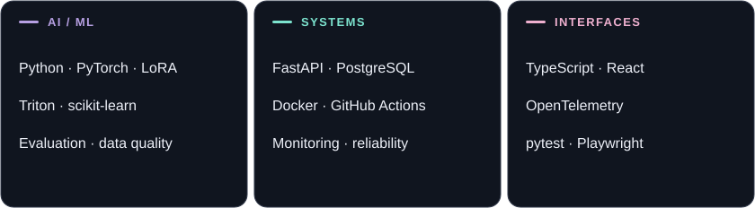
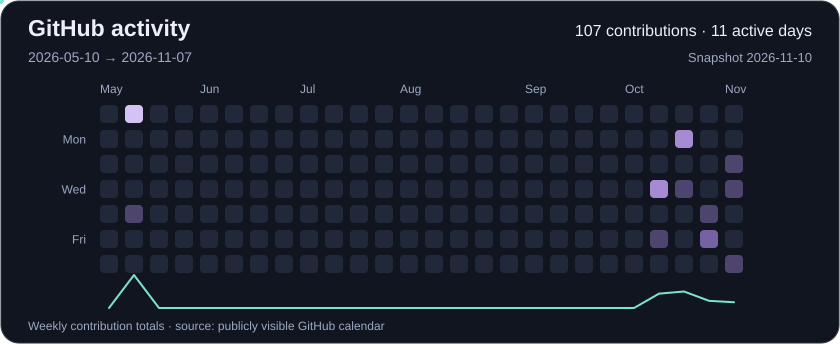

  <picture>
    <source media="(prefers-reduced-motion: reduce)" srcset="assets/ai-atelier-static.webp">
    
  </picture>

<h1 align="center">Rymbek Nazerke</h1>

<strong>AI Engineer</strong>

  <picture>
    <source media="(prefers-reduced-motion: reduce)" srcset="assets/focus-static.svg">
    
  </picture>

  <a href="#selected-projects">Projects</a> &nbsp;·&nbsp;
  <a href="#toolkit">Toolkit</a> &nbsp;·&nbsp;
  <a href="#activity">Activity</a>

## About

I'm an **AI Engineer** working on LLM fine-tuning, model evaluation, and ML systems. I turn ideas into reproducible experiments and practical tools — from a LoRA training loop to a model-monitoring pipeline.

My focus is on **data quality, numerical correctness, and results you can inspect**. I work primarily with Python and PyTorch, and use TypeScript and React to make technical tools easier to explore.

По-русски

Я Назерке, **ИИ-инженер**. Работаю над дообучением языковых моделей, оценкой их качества и ML-системами. Мне интересен весь путь: от подготовки данных и проверки гипотезы до инструмента, которым удобно пользоваться.

В моих проектах — эксперименты с LoRA, Triton-ядра, мониторинг моделей и приложения с ИИ. Особое внимание уделяю воспроизводимости, корректности вычислений и проверяемым результатам.

## Selected projects

**[TuneProof](https://github.com/nazek52/tuneproof)** · LLM fine-tuning & evaluation  
A CPU-runnable LoRA experiment with leakage-aware dataset splits, held-out evaluation, and a zero-learning-rate control. [Inspect the evidence →](https://github.com/nazek52/tuneproof/blob/main/evidence/README.md)  
Python · PyTorch · LoRA

**[Soup Kernel Lab](https://github.com/nazek52/soup-kernel-lab)** · ML systems  
Custom Triton RMSNorm and cross-entropy kernels with value and gradient checks, CPU reports, and a benchmark notebook. GPU performance is not yet measured.  
Python · PyTorch · Triton

**[Drift Sentinel](https://github.com/nazek52/drift-sentinel)** · Model monitoring  
Chronological evaluation, delayed-label cutoffs, and drift diagnostics on a reproducible synthetic incident dataset.  
Python · scikit-learn · MLOps

**[FloodShield](https://github.com/nazek52/FloodShield)** · Applied AI  
Source-linked field-report extraction with a server-side Meta integration, human review, and geospatial scenarios. The [public demo](https://nazek52.github.io/FloodShield/) supports simulation and manual review.  
JavaScript · Node.js · GeoJSON · Meta API

**[Release Guard](https://github.com/nazek52/release-guard)** · Reliable delivery  
An explainable canary gate that returns PASS, FAIL, or HOLD from baseline and candidate metrics.  
Python · statistics · Docker · CI/CD

**[Trace Lens](https://github.com/nazek52/trace-lens)** · Observability  
Explore OTLP traces in a browser waterfall and investigate latency while keeping trace data local.  
TypeScript · React · Web Workers

## Toolkit

<picture>
  <source media="(max-width: 600px) and (prefers-color-scheme: light)" srcset="assets/stack-light-mobile.svg">
  <source media="(max-width: 600px)" srcset="assets/stack-dark-mobile.svg">
  <source media="(prefers-color-scheme: light)" srcset="assets/stack-light.svg">
  
</picture>

## Activity

<picture>
  <source media="(max-width: 600px) and (prefers-reduced-motion: reduce) and (prefers-color-scheme: light)" srcset="assets/activity/calendar-light-mobile-static.svg">
  <source media="(max-width: 600px) and (prefers-reduced-motion: reduce)" srcset="assets/activity/calendar-dark-mobile-static.svg">
  <source media="(prefers-reduced-motion: reduce) and (prefers-color-scheme: light)" srcset="assets/activity/calendar-light-static.svg">
  <source media="(prefers-reduced-motion: reduce)" srcset="assets/activity/calendar-dark-static.svg">
  <source media="(max-width: 600px) and (prefers-color-scheme: light)" srcset="assets/activity/calendar-light-mobile.svg">
  <source media="(max-width: 600px)" srcset="assets/activity/calendar-dark-mobile.svg">
  <source media="(prefers-color-scheme: light)" srcset="assets/activity/calendar-light.svg">
  
</picture>

26 complete weeks from my publicly visible GitHub calendar. The current partial week is excluded. [Source data](assets/activity/data.json) · [Weekly refresh](https://github.com/nazek52/nazek52/actions/workflows/profile-activity.yml)

<strong>More engineering work & walkthroughs</strong>

- [Relay Ledger](https://github.com/nazek52/relay-ledger) — durable webhook delivery with idempotency, signed payloads, retries, and worker-crash recovery.
- [Shift Ledger](https://github.com/nazek52/shift-ledger) — acknowledged incident handoffs with role checks and a versioned audit trail.
- [Service Observability & Recovery](https://github.com/nazek52/service-observability-recovery-lab) — PostgreSQL, Prometheus/Grafana, and outage/recovery exercises.
- [Containerized Service Delivery](https://github.com/nazek52/containerized-web-service-delivery-lab) — a focused container delivery lab.
- [TuneProof: русский разбор](https://github.com/nazek52/tuneproof/blob/main/docs/DEFENSE_RU.md)
- [Soup Kernel Lab: устройство проекта](https://github.com/nazek52/soup-kernel-lab/blob/main/docs/START_HERE_RU.md)

---

Independent portfolio projects developed with AI assistance. Experiment scope, synthetic data, and limitations are documented in each repository. [About the artwork](ARTWORK.md).
